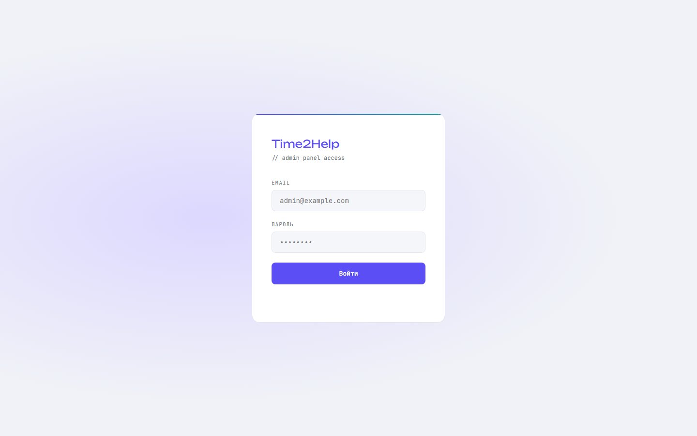

# Time2Help — панель администратора

Веб-панель для управления волонтёрской платформой [Time2Help](https://github.com/TheFulum/-time2help.app): пользователи, мероприятия, заявки, чаты и рассылки.

**Открыть:** https://thefulum.github.io/time2help.admin/ (вход только для администраторов)

## О проекте

Мобильное приложение Time2Help рассчитано на волонтёров и организаторов, а администратору удобнее работать с большого экрана. Панель подключается к той же базе Firestore, что и приложение, и даёт полный доступ к данным платформы.

## Возможности

- Вход по email и паролю через Firebase Authentication с проверкой роли администратора.
- **Пользователи**: просмотр, редактирование, блокировка и удаление.
- **Мероприятия и еженедельные серии**: создание, редактирование, удаление.
- **Заявки волонтёров**: быстрое одобрение и отклонение.
- **Справочник навыков**: добавление и удаление.
- **Чаты, отзывы и рейтинги**: просмотр и модерация.
- **Уведомления**: просмотр и массовая рассылка пользователям.

## Технологии

- HTML, CSS, JavaScript в одном файле, без сборки
- Firebase JS SDK 10: Authentication, Cloud Firestore
- GitHub Pages для публикации

## Запуск

Откройте `index.html` в браузере или через любой локальный HTTP-сервер. Параметры подключения к Firebase задаются в начале скрипта страницы.

---

Автор — [Липовский Даниил](https://github.com/TheFulum)
